  <!-- BRAND HEADER -->
  

   

   
  

   
  

  

 

# 👋 Who Am I?

> *"Behind every dataset lies a story waiting to be understood — I just build the tools to read it."*

Hi, I'm **Bảo Châu (Pandora)**. I'm fascinated by **the architecture of computation, the logic of algorithms and data-driven insights**, and I love turning real-world problems into clean, algorithmic solutions and working software. I balance **rigorous mathematical thinking** with **strong global communication skills**, always looking for the logic underneath the noise.

<table align="center">
  <tr>
    <td align="center" valign="top" width="33%">
      

      
<b>Algorithmic Thinker</b>

      
I break problems down mathematically and design clean algorithms before writing a single line of code.

    </td>
    <td align="center" valign="top" width="33%">
      

      
<b>Software Builder</b>

      
I enjoy building software end to end, from the core logic to a tool that people can actually use.

    </td>
    <td align="center" valign="top" width="33%">
      

      
<b>Global Communicator</b>

      
Fluent in collaborating across languages, cultures and time zones.

    </td>
  </tr>
</table>

 

# 🎯 What I'm Up To

 

 

 

 

# 🚀 Featured Projects

&nbsp;&nbsp;&nbsp;&nbsp;&nbsp;&nbsp;
  
&nbsp;&nbsp;&nbsp;&nbsp;&nbsp;&nbsp;

 

# 💻 Tech Stack

**Languages**

&nbsp;&nbsp;
&nbsp;&nbsp;
&nbsp;&nbsp;

**Tools & Environment**

&nbsp;&nbsp;
&nbsp;&nbsp;
&nbsp;&nbsp;

**Data & Machine Learning**

&nbsp;&nbsp;
&nbsp;&nbsp;
&nbsp;&nbsp;
&nbsp;&nbsp;

 

# 📊 Telemetry & Stats

  
  

  

  

 

# ⚡ Contribution Animations

  

  

 

 

# 🤝 Let's Connect

&nbsp;&nbsp;
&nbsp;&nbsp;
&nbsp;&nbsp;

⭐ If you like what you see, a star on any repo is always appreciated.

